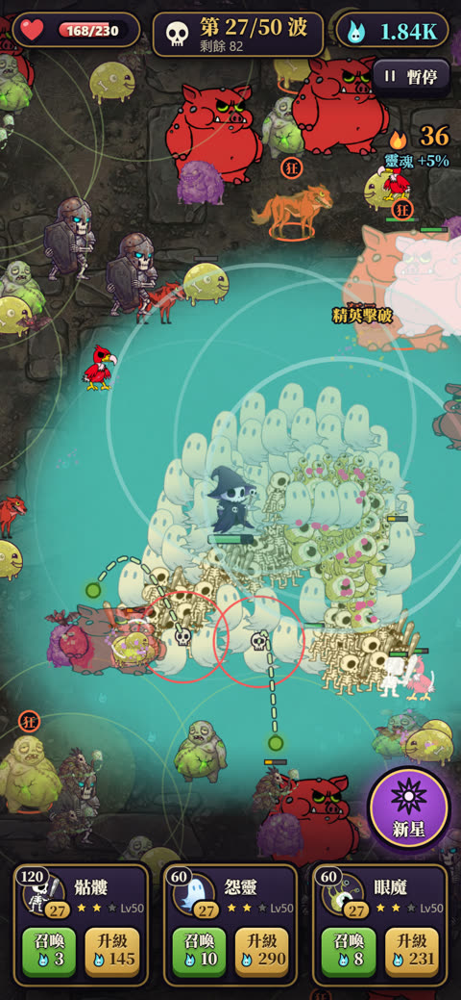
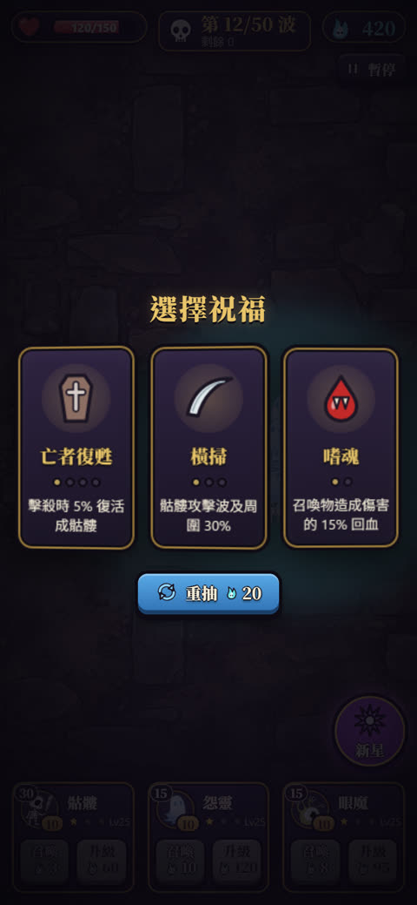
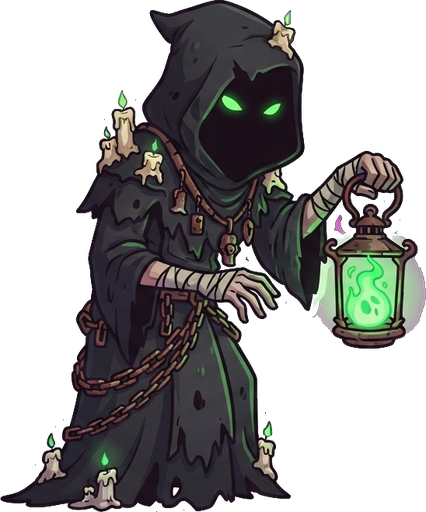
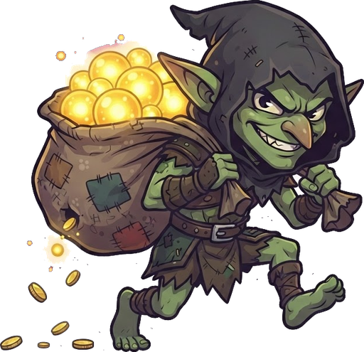
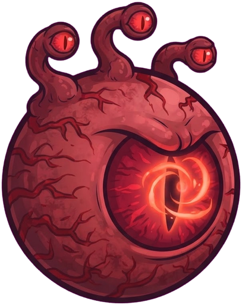
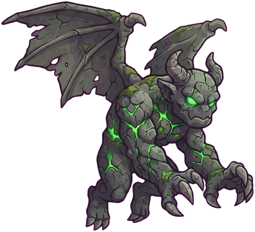
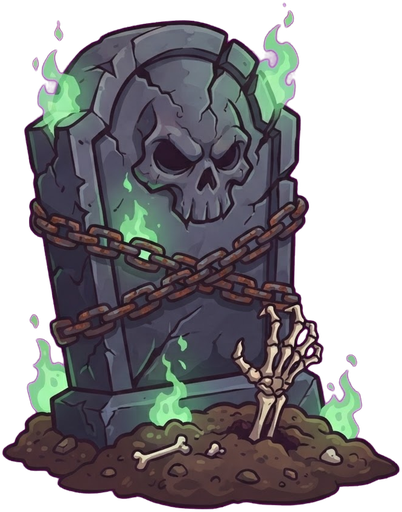
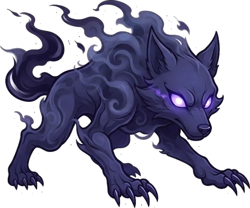

# 亡靈狂潮 · Undead Frenzy

**召喚沒有上限的骷髏大軍，撐過 50 波怪物浪潮。**

打開瀏覽器就能玩，手機、電腦都可以，不用安裝；想要的話也能裝成 App，全螢幕、沒網路也能玩。

  

 

## 一局怎麼玩

1. **打怪撿靈魂**：法師會自動對附近的怪射靈魂彈；怪物死掉會噴出靈魂，走過去就會吸過來
2. **召喚與升級**：用靈魂召喚骷髏、怨靈、眼魔，或把同一種全部升一級。同種兵越多，再召喚一隻就越貴，兵多了就該升級
3. **挑祝福還是保命**：每 3 波和每隻首領之後，從三張祝福裡挑一張變強；但波與波之間法師和召喚物都不會回血，血太少時可以放棄祝福、把法師的血補滿
4. **撐到第 50 波**：每 10 波一隻首領，最後是墮落亡靈王。打贏可以收工，也可以繼續挑戰無盡模式
5. **變強再來**：結束時依撐過的波數拿靈魂結晶，換成下一局也有效的永久強化

一局大約 25 分鐘，每波結束自動存檔，關掉下次再接著打。

 

## 你的亡靈大軍

<table>
  <tr>
    <td align="center" width="33%">
       
      <b>骷髏</b> 
      近戰主力，便宜又耐打
    </td>
    <td align="center" width="33%">
       
      <b>怨靈</b> 
      光環讓周圍敵人變慢，死掉時爆炸
    </td>
    <td align="center" width="33%">
       
      <b>眼魔</b> 
      遠程射擊，躲在後排輸出
    </td>
  </tr>
</table>

升到 **Lv10／25／50** 會進化：體型變大、換顏色，還會學會爆擊、彈射、脈衝之類的新能力。

 

## 會遇到的敵人

越後面的波次出現越多新面孔，每種第一次登場時畫面上都會告訴你怎麼對付。

<table>
  <tr>
    <td align="center" width="33%"> <b>瘟膿史萊姆</b> 打死會分裂</td>
    <td align="center" width="33%"> <b>暗影刺客</b> 隱身接近，腳下出現紅圈就快走開</td>
    <td align="center" width="33%"> <b>腐骨巫醫</b> 會幫怪物補血，先殺牠</td>
  </tr>
  <tr>
    <td align="center"> <b>吸血蝙蝠群</b> 直撲法師</td>
    <td align="center"> <b>骨盾衛兵</b> 盾牌擋飛彈，要靠骷髏近戰</td>
    <td align="center"> <b>屍蟲</b> 從地底鑽出，紅圈出現就走開</td>
  </tr>
  <tr>
    <td align="center"> <b>墓地祭司</b> 把陣亡的召喚物變成敵人</td>
    <td align="center"> <b>腐屍</b> 貼近後膨脹自爆，趁膨脹時打掉</td>
    <td align="center"> <b>金魂竊賊</b> 一直逃跑，追到能拿大量靈魂</td>
  </tr>
  <tr>
    <td align="center"> <b>血瞳</b> 隔著大軍朝法師射血彈，走動就躲得掉</td>
    <td align="center"> <b>腐翼石像鬼</b> 會飛，骷髏打不到，專撲眼魔</td>
    <td align="center"> <b>吞魂者</b> 搶吃地上的靈魂，越吃越大</td>
  </tr>
  <tr>
    <td align="center"> <b>招魂墓碑</b> 在畫面外一直冒小怪，帶大軍去拆有大獎</td>
    <td></td>
    <td></td>
  </tr>
</table>

還有往你腳下丟毒池的瘟疫投手，以及第 21 波起帶詞綴的精英怪：綠光環繞的打死會分裂，腳下冒火的殘血會暴走。

 

## 首領

<table>
  <tr>
    <td align="center" width="20%"> <b>骸骨巨像</b></td>
    <td align="center" width="20%"> <b>疫病母巢</b></td>
    <td align="center" width="20%"> <b>暗影獵手</b></td>
    <td align="center" width="20%"> <b>腐朽骨龍</b></td>
    <td align="center" width="20%"> <b>墮落亡靈王</b> 第 50 波</td>
  </tr>
</table>

大招出手前地上都會先亮出範圍；首領跑出畫面時，邊緣會有箭頭指出牠在哪。

 

## 讓每一局都不一樣

- **21 種祝福**：可以重複疊層，例如全押眼魔多重射擊、讓法師一次射好幾顆靈魂彈，或讓擊殺的怪物復活成骷髏
- **流派共鳴**：祝福分成骷髏、眼魔、怨靈、法師、靈魂五個流派，同流派疊到 3 層、6 層各觸發一次共鳴（骨潮、千眼、冥域……）；抽卡會偏向你已經在走的流派，看不上的祝福可以放逐，三張都不要就跳過換一筆靈魂。重抽是整局共用的次數（開局 2 次，每打倒一隻首領補 1 次），省著用
- **10 種傳說祝福**：打倒首領後的三選一必有一張金框傳說，平常偶爾也會冒出來。每一種都能撐起一套打法：每 8 隻骷髏出一隻巨人、眼魔的彈連跳、新星凍住全場、擊殺精英就重置新星、法師吸靈魂回血……
- **6 種契約**：第 6 波起偶爾冒出一張暗紅色的契約卡，好處很大、壞處跟著整局，例如召喚物傷害 +50% 但法師血量 -30%、靈魂掉落 +50% 但怪物血量 +25%
- **戰場遺跡**：開戰後畫面外不時冒出一座遺跡，畫面邊緣有箭頭指路，外圈是它還能撐多久的倒數（可以跨好幾波）。帶著大軍走過去站上去：戰鼓祭壇讓大軍狂暴 12 秒、靈泉回血（越殘越常出現，喝不完下次再來）、封印寶棺開出一大筆靈魂，有時多送一次祝福。中期起有時兩座同時出現在相反方向，走進一座、另一座就崩塌
- **波次事件**：血月、精英潮、狂暴、腐屍狂潮、金魂竊賊，不定期出現。一波拖超過 2 分鐘會「怨氣沸騰」：先倒數 15 秒，之後怪越來越快、越來越痛，不會被追著繞圈好幾分鐘
- **連殺**：一直殺不停，靈魂掉得越多
- **排行榜**：綜合榜和每個職業各留前十名，通關的照通關時間排、沒通關的照撐到第幾波排。一開始榜上是十位亡靈議會的對手，從第 7 波排到 21 分半通關，戰鬥中撐過誰的紀錄畫面就會喊出來；打完首領波會告訴你比自己最快的那次快還是慢，結算時寫著再撐幾波能超越下一個人。上榜時跳出恭喜並請你留名字，點一筆可以看那局的擊殺、祝福等細節（紀錄存在這台裝置上）
- **永久強化**：剛開始沒強化很難打倒亡靈王，一局一局變強直到通關。每撐過一波、每打倒一隻首領都會拿到靈魂結晶（畫面右上角看得到這局賺了多少），換全軍傷害、主角與召喚物血量、大招冷卻、倒下時復活一次、多一張祝福可選等 11 種強化，七個職業都吃得到；第一局拿到的就買得起好幾級。隨時可以免費全部退還、換一套搭配
- **詛咒**：通關後解鎖，共 8 級，每級多一條規則，結晶也拿得更多
- **每日變異**：每天換一條特殊規則，像是只能召喚眼魔、每一波都是血月、法師血量只剩四分之一但傷害加倍。當天第一場的結晶 ×2
- **147 個成就**：分成征途、無盡、詛咒、首領、怪物圖鑑、大軍、共鳴、傳說、契約、連殺、遺跡、每日、生涯、挑戰、傳承 15 類，每個都有自己的圖示。有每局都摸得到的（撐過第 5 波、連殺 100），也有要玩很久的（累計打倒 100 萬隻怪）和刁鑽的（只召喚怨靈通關、一次新星都不放通關）。第一次達成就送結晶

 

## 操作

| | 手機 | 鍵盤 |
| :--- | :--- | :--- |
| 移動 | 在畫面任何地方按住拖曳，拉越遠走越快 | WASD／方向鍵 |
| 召喚 | 點或長按「召喚」 | 1 骷髏・2 怨靈・3 眼魔 |
| 升級 | 點或長按「升級」 | Shift + 1／2／3 |
| 死亡新星（炸開身邊的敵人、大軍狂暴 4 秒、吸走滿地靈魂） | 點右下角「新星」 | 空白鍵 |
| 選祝福 | 點卡片 | 1／2／3（／4） |
| 提早開戰 | 波次之間點「開戰」 | |
| 暫停 | 點「暫停」或手機的返回鍵 | Esc／P |

暫停時可以看本局已選的祝福、調音量，或按「結束這局」直接結算拿結晶。

 

## 小技巧

- **升級鈕發金光就升級**：代表這時候升一級比多召喚划算，兵越多越值得升
- **大戰正熱時放新星**：大軍攻速暴增、滿地靈魂一口氣吸回來；但被包圍時它也是救命招，別全拿去進攻。冷卻好時按鈕會發光
- **骷髏擋前面、眼魔打後面**：骨盾衛兵和牠腳下那圈裡的怪，眼魔完全打不動，要派骷髏衝進去（法師的靈魂彈打得穿）
- **巫醫和祭司優先處理**，放著不管怪物會越打越多
- **遺跡要整支軍隊一起去**：法師自己跑過去很容易被包圍；先清出一條路，讓大軍跟上再站上去
- 法師本身很脆，**邊走邊打**比站著不動安全

 

