

# 亡靈狂潮 · Undead Frenzy

**七個職業、七套完全不同的打法，撐過 50 波怪物浪潮。**

打開瀏覽器就能玩，手機、電腦都可以，不用安裝；想要的話也能裝成 App，全螢幕、沒網路也能玩。

  

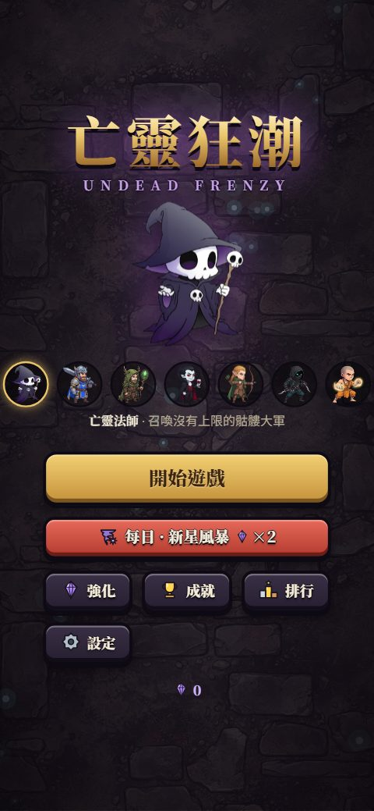

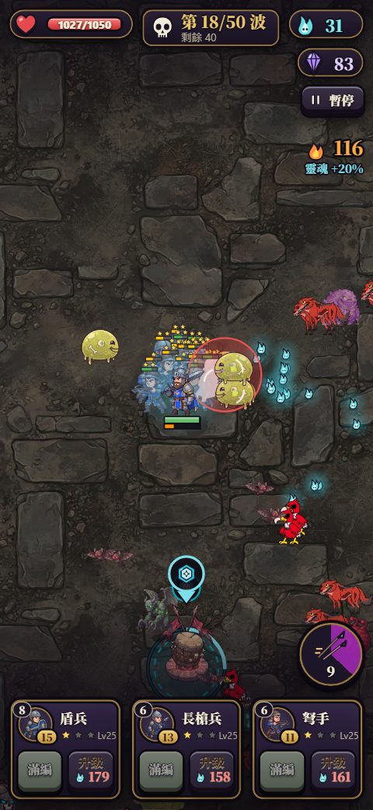
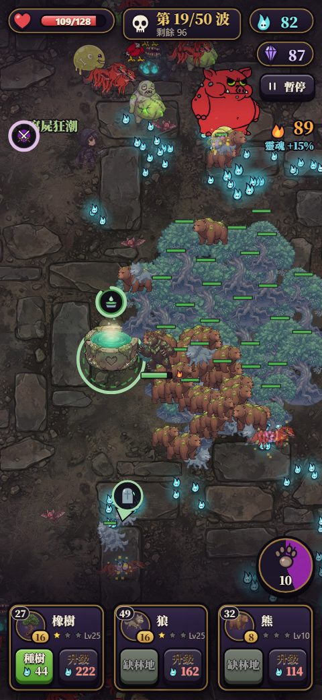
 
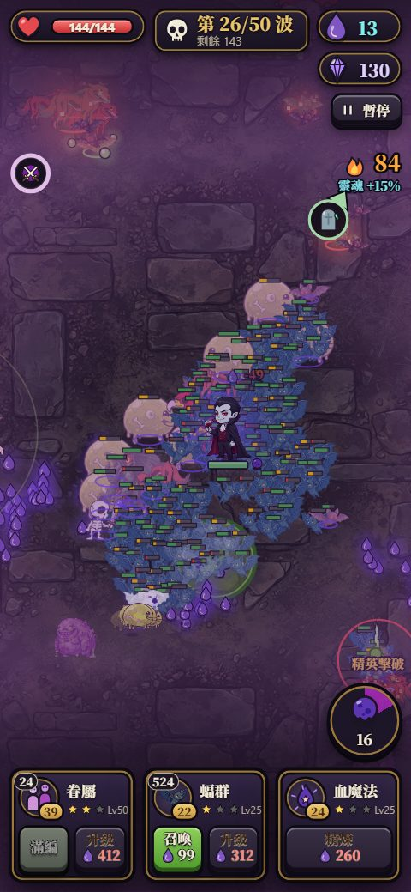
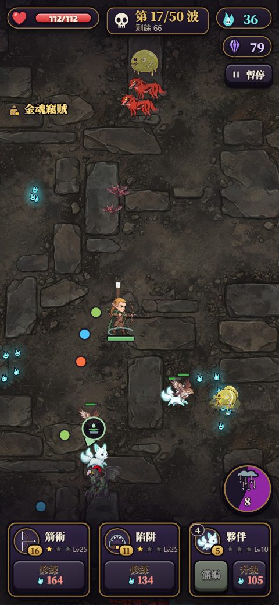
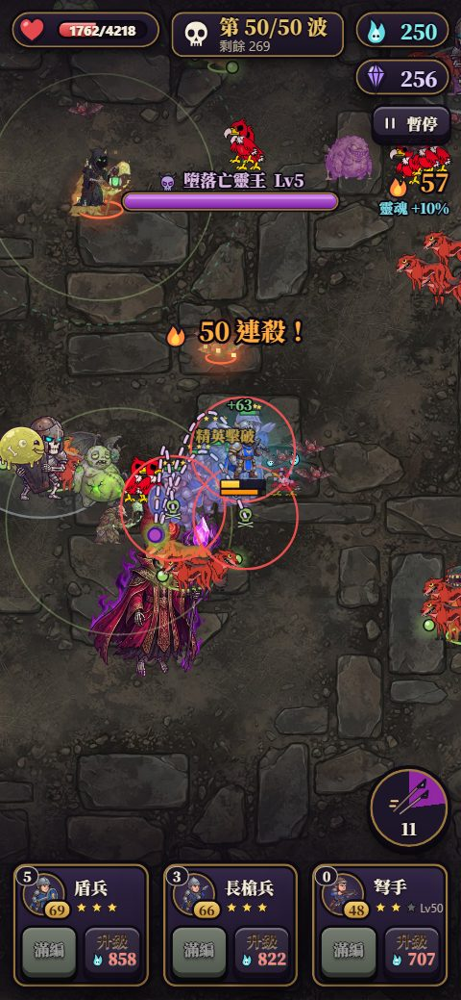

 

## 一局怎麼玩

1. **打怪撿靈魂**：主角會自動攻擊附近的怪；怪物死掉會噴出靈魂，走過去就會吸過來
2. **用底部三張卡變強**：每個職業有自己的三張卡，召喚手下、招募士兵、修練功夫……把靈魂花在哪裡就是你的打法
3. **挑祝福還是保命**：每 3 波和每隻首領之後，從三張祝福裡挑一張變強；但波與波之間不會回血，血太少時可以放棄祝福、把主角的血補滿
4. **撐到第 50 波**：每 10 波一隻首領，最後是墮落亡靈王。打贏可以收工，也可以繼續挑戰無盡模式
5. **變強再來**：結束時依撐過的波數拿靈魂結晶，換成下一局也有效的永久強化

一局大約 25 分鐘，每波結束自動存檔，關掉下次再接著打。

 

## 七個職業

每個職業都改掉一兩條核心規則，再配一個看得見的代價：戰力從哪來、靈魂拿去做什麼、每一秒在操心什麼，都不一樣。一開始只有亡靈法師，其他六個靠成就解鎖。

<table>
  <tr>
    <td align="center" width="25%"> <b>亡靈法師</b> 召喚沒有上限的骷髏大軍 大招：新星</td>
    <td align="center" width="25%"> <b>戰士</b> · 鐵血軍團長 少數精兵排成陣型，自己站最前線 大招：標槍齊射 🔓 撐過第 20 波</td>
    <td align="center" width="25%"> <b>德魯伊</b> · 橡樹賢者 種下橡樹，在自己選的林地打這一仗 大招：巨熊化身 🔓 累計啟動 30 座戰場遺跡</td>
    <td align="center" width="25%"> <b>吸血鬼</b> · 血月伯爵 血就是錢，打倒的怪站起來為你而戰 大招：血月降臨 🔓 撐過第 30 波</td>
  </tr>
  <tr>
    <td align="center">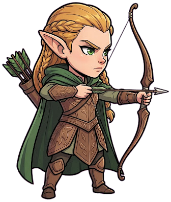 <b>精靈弓箭手</b> · 風行者 邊退邊回頭射，停下來就變弱 大招：箭雨 🔓 打倒墮落亡靈王</td>
    <td align="center"> <b>刺客</b> · 阿拉穆特之影 潛進怪堆，刺殺標記的目標 大招：斬首 🔓 累計打倒 500 隻精英怪</td>
    <td align="center">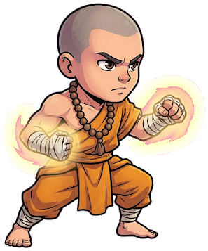 <b>武僧</b> · 少林拳師 沒有手下，連擊就是一切 大招：十八羅漢陣 🔓 撐過第 40 波</td>
    <td></td>
  </tr>
</table>

每個職業都有自己的普攻、三張卡、大招、五個專屬流派、3 張專屬傳說祝福、專屬成就與最快通關紀錄，連走到戰場遺跡上的反應都不一樣。手下的兵升到 **Lv10／25／50** 會進化：體型變大、換顏色、多一個新能力。

 

## 會遇到的敵人

越後面的波次出現越多新面孔，每種第一次登場時畫面上都會告訴你怎麼對付。

<table>
  <tr>
    <td align="center" width="33%"> <b>瘟膿史萊姆</b> 打死會分裂</td>
    <td align="center" width="33%">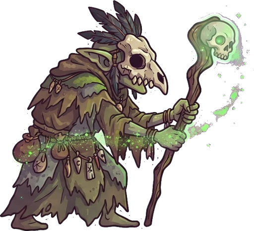 <b>腐骨巫醫</b> 會幫怪物補血，先殺牠</td>
    <td align="center" width="33%"> <b>吸血蝙蝠群</b> 繞過大軍直撲主角，靠遠程打下來</td>
  </tr>
  <tr>
    <td align="center">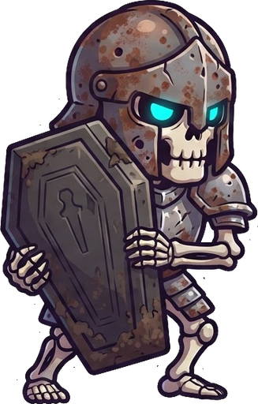 <b>骨盾衛兵</b> 盾牌擋飛彈，要靠近戰打破</td>
    <td align="center">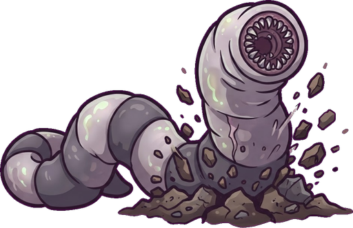 <b>屍蟲</b> 從地底鑽出，紅圈出現就走開</td>
  </tr>
  <tr>
    <td align="center"> <b>墓地祭司</b> 把陣亡的手下變成敵人</td>
    <td align="center"> <b>腐屍</b> 貼近後膨脹自爆，趁膨脹時打掉</td>
    <td align="center"> <b>金魂竊賊</b> 一直逃跑，追到能拿大量靈魂</td>
  </tr>
</table>

還有專撲遠程的腐翼石像鬼（會飛，近戰打不到）、往大軍丟毒池的瘟疫投手，以及第 21 波起帶詞綴的精英怪：綠光環繞的打死會分裂，腳下冒火的殘血會暴走。

戰鬥畫面上，**紅色只代表危險**：敵人的攻擊、預警圈、低血量都是紅的，自己人的攻擊和特效一律不用紅，一眼就分得出要不要躲。

 

## 首領

<table>
  <tr>
    <td align="center" width="20%"> <b>骸骨巨像</b></td>
    <td align="center" width="20%"> <b>疫病母巢</b></td>
    <td align="center" width="20%"> <b>暗影獵手</b></td>
    <td align="center" width="20%">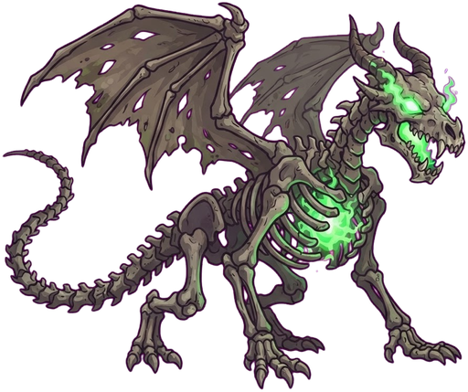 <b>腐朽骨龍</b></td>
    <td align="center" width="20%"> <b>墮落亡靈王</b> 第 50 波</td>
  </tr>
</table>

每隻首領都是一場三階段的戰鬥：出場時鏡頭帶到牠身上報名字；牠身上有一層金色**護甲**，護甲在時打不痛，打破後首領**破防**暈眩、受到的傷害加重，這時候放大招最划算；血量打到三分之二、三分之一時換階段，怒吼震開大軍、叫出小怪、變得更強。

大招出手前地上都會先亮出範圍，瞄準你的招式還會響一聲預警；首領跑出畫面時，邊緣會有箭頭指出牠在哪。

 

## 讓每一局都不一樣

- **244 種祝福、35 個流派**：每個職業五個專屬流派，加上所有職業共用的靈魂流派。祝福可以重複疊層，分成普通、稀有（藍框）、傳說（金框）三種：每個流派一張稀有祝福，偶爾才出現，常常不是你在走的那一路，拿不拿要自己掂量；抽卡會偏向你已經在走的流派，看不上的祝福可以在強化畫面先放逐，之後每局都不會出現。重抽是整局共用的次數（開局 2 次，每打倒一隻首領補 1 次），省著用
- **28 種傳說祝福**：打倒首領後的三選一必有一張金框傳說，平常偶爾也會冒出來。每一種都能撐起一套打法：每 8 隻骷髏出一隻巨人、老兵陣亡後下一波歸隊、新星凍住全場……
- **戰場遺跡**：開戰後遠處不時冒出一座遺跡，畫面邊緣有箭頭指路，外圈是它還能撐多久的倒數（可以跨好幾波）。帶著隊伍走過去站上去：
  - **祭壇**：頭上的圖示和地上圈的顏色直接告訴你是哪一種：戰鼓祭壇讓大軍狂暴、護佑祭壇讓你 10 秒內受傷減半、遲滯祭壇讓全場怪物變慢
  - **靈泉**：回血，越殘越常出現，喝不完下次再來
  - **封印寶棺**：開出一大筆靈魂、一張祝福，或讓隨機一種手下直接升 2 級
  - 中期起有時兩座同時出現在相反方向，走進一座、另一座就崩塌
- **波次事件**：百鬼夜行、精英潮、躁動、腐屍狂潮、金魂竊賊，不定期出現。一波拖超過 2 分鐘會「怨氣沸騰」：先倒數 15 秒，之後怪越來越快、越來越痛，不會被追著繞圈好幾分鐘
- **排行榜**：綜合榜和每個職業各留前十名，通關的照通關時間排、沒通關的照撐到第幾波排。一開始榜上是十位亡靈議會的對手，結算時寫著再撐幾波能超越下一個人。上榜時放煙火、依成績說一句祝賀詞（新榜首、通關、職業第一、超越對手……），再請你留名字；點一筆可以看那局的擊殺、祝福等細節（紀錄存在這台裝置上）
- **永久強化**：剛開始沒強化很難打倒亡靈王，一局一局變強直到通關。每撐過一波、每打倒一隻首領都會拿到靈魂結晶（暫停選單看得到這局賺了多少），換傷害、主角與手下血量、大招冷卻、倒下時復活一次、多一張祝福可選等 11 種強化，七個職業都吃得到；第一局拿到的就買得起好幾級。隨時可以免費全部退還、換一套搭配
- **詛咒**：通關後解鎖，共 8 級，每級多一條規則，結晶也拿得更多
- **257 個成就**：分成征途、無盡、詛咒、首領、圖鑑、大軍、稀有、傳說、遺跡、生涯、挑戰、職業、傳承 13 類，每個都有自己的圖示。有每局都摸得到的（撐過第 5 波、連殺 100），也有要玩很久的（累計打倒 100 萬隻怪）和刁鑽的（只召喚怨靈通關、一次新星都不放通關）；每個職業另有 12 個專屬成就。第一次達成就送結晶

 

## 操作

| | 手機 | 鍵盤 |
| :--- | :--- | :--- |
| 移動 | 在畫面任何地方按住拖曳，拉越遠走越快 | WASD／方向鍵 |
| 底部三張卡（召喚、招募、修練…） | 點或長按卡片上的按鈕 | 1／2／3 |
| 升級 | 點或長按「升級」 | Shift + 1／2／3 |
| 大招 | 點右下角的大招鈕 | 空白鍵 |
| 選祝福 | 點卡片 | 1／2／3（／4） |
| 提早開戰 | 波次之間點「開戰」 | |
| 暫停 | 點「暫停」或手機的返回鍵 | Esc／P |

暫停時可以看本局已選的祝福、調音量，或按「結束這局」直接結算拿結晶。

 

## 小技巧

- **升級鈕發金光就升級**：代表這時候升一級比多召喚划算，兵越多越值得升
- **大招留給最需要的時候**：混戰正熱時放能一口氣扭轉戰局，被包圍時也是救命招，別全拿去進攻。冷卻好時按鈕會發光
- **近戰擋前面、遠程打後面**：骨盾衛兵和牠腳下那圈裡的怪，飛彈打不動，要派近戰衝進去
- **巫醫和祭司優先處理**，放著不管怪物會越打越多
- **遺跡先看頭上的圖示再決定要不要去**：需要保命就去護佑、被追著打就去遲滯；整支隊伍一起過去，主角自己跑過去很容易被包圍
- 主角大多很脆，**邊走邊打**比站著不動安全

 

